# Plano de Avaliação do Projeto por Ponto de Função – SIGATCC (TP3)

Pacote da EAP **1.4 Pontos de função e valor** · atividade **C10** · marco **E2 (18/11/2026)**
Responsável: Tiago Feitosa · Revisão: 12/11/2026 (contagem por tela acrescentada em 20/11/2026) · Base: contagem de 08/11 (234 PF), planilha *SIGATCC_Cronograma_EAP_PF_v4*

Este plano diz **como a equipe mede o tamanho do SIGATCC em pontos de função (PF) e usa essa medida para avaliar o projeto**: quanto já foi entregue, a que custo, com que produtividade e se o ritmo cabe no prazo. A contagem detalhada está na aba *Pontos de Função* da planilha de cronograma; aqui ficam o método, a linha de base, as métricas, os limites de alerta e a rotina de acompanhamento.

Critério de aceite do pacote 1.4: contagem por módulo revisada por 2 pessoas; **plano de avaliação por PF pronto** (este documento); produtividade calibrada com horas reais (D25, seção 6).

---

## 1. Objetivos

1. Ter uma medida de tamanho que não depende da tecnologia, para comparar o que foi planejado com o que foi entregue.
2. Converter tamanho em esforço e em valor (custo simbólico) de forma rastreável.
3. Acompanhar o desempenho do projeto a cada marco (E2, E3, E4) com indicadores objetivos.
4. Dar base às decisões de corte de escopo quando o ritmo real não couber no prazo (seção 4.1.2.4 do Plano de Integração).

## 2. Método de contagem

| Item | Decisão |
|---|---|
| Padrão | IFPUG (CPM 4.3) para as funções de dados; NESMA estimada para as transações até o detalhamento de TD e AR |
| Tipo de contagem | Projeto de desenvolvimento |
| Medida | PF **não ajustados**: o fator de ajuste (VAF) não é aplicado, como no IFPUG a partir do CPM 4.3, em que ele é opcional e fica fora do tamanho funcional |
| Fronteira da aplicação | O SIGATCC (SPA + API + banco). Ficam fora: o Resend (serviço de e-mail chamado pela API) e o navegador |
| Propósito | Estimar esforço e valor e avaliar o desempenho do projeto |
| Fonte das funções | RAN e RBN da planilha de requisitos v2; DER v2 para as funções de dados |

Tabela de contribuição usada (aba *Parâmetros*):

| Tipo | Baixa | Média | Alta | Padrão NESMA |
|---|---|---|---|---|
| ALI – arquivo lógico interno | 7 | 10 | 15 | Baixa |
| AIE – arquivo de interface externa | 5 | 7 | 10 | Baixa |
| EE – entrada externa | 3 | 4 | 6 | Média |
| SE – saída externa | 4 | 5 | 7 | Média |
| CE – consulta externa | 3 | 4 | 6 | Média |

### 2.1 Regras de contagem da equipe (decisões D20 a D24)

- **Generalização = um ALI** (D22): docente, aluno e membro externo são um ALI *Usuário* com 4 registros lógicos.
- **Reunião de alinhamento é registro lógico da solicitação de orientação** (D23), e não um ALI próprio.
- **Login conta como CE** (D24), um para o docente e um para o aluno.
- **O convite automático faz parte de "Incluir banca"** (D24); reenviar e responder convite são EE próprias.
- **Exportação não conta à parte** (D24): é outra forma de apresentar a mesma SE.
- **Campos de formulário fazem parte do processo** (D24): anexar comprovante e escolher a visibilidade não são transações separadas.
- **Listagem com contagens = uma SE** (D24): a lista de professores com orientandos e bancas é uma única SE.
- **Sem duplicidade entre pacotes** (D20, D21): o cadastro de professor fica só no pacote 4.4; "Excluir banca" saiu do escopo.

## 3. Linha de base (contagem de 08/11)

**Total: 234 PF não ajustados, em 51 funções.**

### 3.1 Por tipo de função

| Tipo | Funções | PF | Método |
|---|---|---|---|
| ALI | 6 | 45 | Detalhada (IFPUG), TD e RLR tirados do DER v2 |
| EE | 23 | 92 | Estimada (NESMA, complexidade média) |
| CE | 13 | 52 | Estimada (NESMA, complexidade média) |
| SE | 9 | 45 | Estimada (NESMA, complexidade média) |
| **Total** | **51** | **234** | 45 PF detalhados (19%) e 189 PF estimados (81%) |

Não há AIE: o SIGATCC não lê dados mantidos por outra aplicação.

### 3.2 Por módulo (entregável da EAP)

| Código | Entregável | PF | % |
|---|---|---|---|
| 3 | Projeto do Sistema (funções de dados) | 45 | 19% |
| 4 | Módulo Perfis e Acesso | 48 | 21% |
| 5 | Módulo Gestão de TCCs | 32 | 14% |
| 6 | Módulo Bancas e Defesas | 32 | 14% |
| 7 | Módulo Orientação Acadêmica | 30 | 13% |
| 8 | Módulo Dashboards e Governança | 39 | 17% |
| 9 | Módulo Acesso Público | 8 | 3% |
| | **Total** | **234** | 100% |

### 3.3 Por marco (o que deve estar entregue em cada um)

| Marco | Data | PF do marco | PF acumulados | % acumulado |
|---|---|---|---|---|
| E1 · TP2 | 25/10 | 81 | 81 | 35% |
| E2 · TP3 | 20/11 (adiada de 18/11) | 69 | 150 | 64% |
| E3 · TP4 | 09/12 | 84 | 234 | 100% |

Os 69 PF da E2 vêm dos pacotes 3.2 (21), 4.2 (20), 8.1 (20), 5.3 (4) e 8.3 (4). Os pacotes 4.5, 4.7 e 6.2 não acrescentam função nova (são regras de acesso e de validação sobre funções já contadas) e por isso não somam PF, embora tenham esforço.

### 3.4 Contagem por tela (protótipo de 20/11)

Para facilitar a conferência, as 45 funções de transação foram localizadas nas telas do sistema. O protótipo abaixo usa o mesmo estilo do front-end (tokens e componentes de `frontend/src/styles.css`) e cobre as 21 telas do escopo, inclusive as do E3 que ainda não existem no código. As páginas do protótipo estão em `docs/tp3/telas/prototipo/` e as imagens, em `docs/tp3/telas/`.

**Como ler cada tela:**

- A faixa escura no alto traz o código da tela, o número de funções, o total de PF e a situação no código.
- Cada **marcador laranja numerado** aponta o elemento que dispara ou mostra uma função. A tabela logo abaixo da imagem liga o número à função da contagem (ID, tipo, complexidade e PF).
- Elementos sem marcador, como filtros, botões de cancelar e mensagens, fazem parte de uma função já contada e não somam PF.
- Cada função aparece em uma única tela, então a soma das telas fecha com a linha de base.
- Tipos: EE = entrada externa; CE = consulta externa; SE = saída externa; ALI = arquivo lógico interno. As transações usam a complexidade padrão NESMA (Média); as funções de dados, a contagem detalhada do DER (seção 2).

As **funções de dados** (ALI) não têm tela própria: são os grupos de dados mantidos pelo sistema e somam 45 PF (tabela 3.4.1). As **transações** somam 189 PF nas 21 telas (tabela 3.4.2). O total é 234 PF, igual ao da seção 3.1.

#### 3.4.1 Funções de dados (sem tela)

| ID | Arquivo lógico interno | TD | RLR | Complexidade | PF |
|----|------------------------|---|----|-------|---|
| PF01 | Usuário (docente, aluno e membro externo, com áreas de interesse) | 17 | 4 | Baixa | 7 |
| PF03 | TCC (situação, histórico de status e publicação) | 25 | 3 | Média | 10 |
| PF04 | Banca (participação e avaliação) | 12 | 3 | Baixa | 7 |
| PF06 | Solicitação de orientação (com reunião de alinhamento) | 10 | 2 | Baixa | 7 |
| PF08 | Convite (banca e audiência) | 6 | 1 | Baixa | 7 |
| PF09 | Log de auditoria | 7 | 1 | Baixa | 7 |
| | **Total** | | | | **45** |

#### 3.4.2 Resumo por tela

| Tela | Nome | Funções | PF | Situação no código |
|----|----------------|------|---|--------------------|
| T01 | Login | 2 | 8 | Implementada na v0.3.0 (E2) |
| T02 | Lista de TCCs | 1 | 4 | Implementada na v0.3.0 (E2) |
| T03 | Cadastro e edição de TCC | 2 | 8 | Implementada na v0.3.0 (E2) |
| T04 | Detalhe do TCC | 4 | 16 | Marcadores 1, 2, 3: implementada · 4: a implementar (E3) |
| T05 | Registrar aprovação por publicação | 1 | 4 | Implementada na v0.3.0 (E2) |
| T06 | Cadastro de banca | 3 | 12 | Marcadores 1: implementada · 3: no código, sem homologação · 2: a implementar (E3) |
| T07 | Banca e defesa | 4 | 16 | Marcadores 1: implementada · 2, 3: no código, sem homologação · 4: a implementar (E3) |
| T08 | Convites recebidos | 2 | 8 | No código desde 13/11, falta homologar (E3) |
| T09 | Acesso temporário do membro externo | 1 | 4 | No código desde 13/11, falta homologar (E3) |
| T10 | Meu perfil (aluno) | 2 | 8 | Implementada na v0.3.0 (E2) |
| T11 | Confirmação de cadastro de aluno | 1 | 4 | Implementada na v0.3.0 (E2) |
| T12 | Docentes (Administrador) | 4 | 17 | Implementada na v0.3.0 (E2) |
| T13 | Cadastro de aluno (Administrador) | 1 | 4 | Implementada na v0.3.0 (E2) |
| T14 | Áreas de interesse do docente | 1 | 4 | Parcialmente implementada (E3) |
| T15 | Buscar orientador | 2 | 9 | No código desde 13/11, falta homologar (E3) |
| T16 | Solicitações de orientação e reuniões | 4 | 16 | No código desde 13/11, falta homologar (E3) |
| T17 | Painel de indicadores | 6 | 30 | Marcadores 1, 2, 3, 4: implementada · 5, 6: a implementar (E3) |
| T18 | Relatório de defesas por dia | 1 | 5 | Protótipo: a implementar no E3 |
| T19 | Log de auditoria | 1 | 4 | Implementada na v0.3.0 (E2) |
| T20 | Consulta pública de TCCs | 1 | 4 | Protótipo: a implementar no E3 |
| T21 | Detalhe público do TCC | 1 | 4 | Protótipo: a implementar no E3 |
| | **Transações** | **45** | **189** | |
| | **Funções de dados (3.4.1)** | **6** | **45** | |
| | **Total** | **51** | **234** | |

#### 3.4.3 Telas

##### T01 · Login (8 PF)

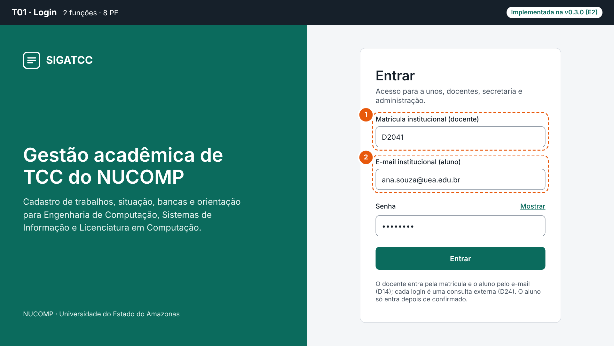{width=16.5cm}

| Nº | Função | Tipo | Complexidade | PF | Pacote · situação |
|---|----------------------|----|-------|---|------------|
| 1 | PF11 · Login do docente | CE | Média | 4 | 4.1 · Implementada (E2) |
| 2 | PF58 · Login do aluno | CE | Média | 4 | 4.2 · Implementada (E2) |
| | **Total da tela** | | | **8** | |

##### T02 · Lista de TCCs (4 PF)

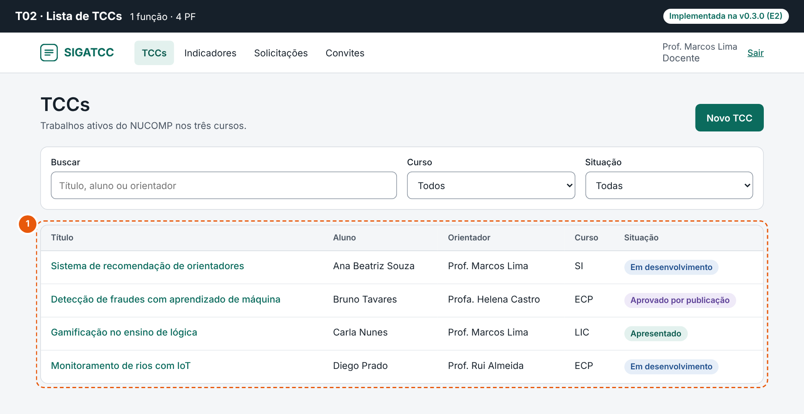{width=16.5cm}

| Nº | Função | Tipo | Complexidade | PF | Pacote · situação |
|---|----------------------|----|-------|---|------------|
| 1 | PF25 · Listar TCCs | CE | Média | 4 | 5.1 · Implementada (E2) |
| | **Total da tela** | | | **4** | |

##### T03 · Cadastro e edição de TCC (8 PF)

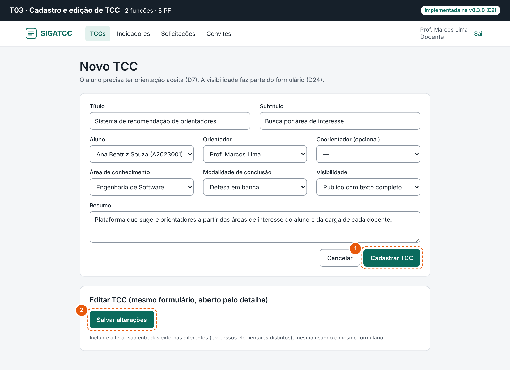{width=16.5cm}

| Nº | Função | Tipo | Complexidade | PF | Pacote · situação |
|---|----------------------|----|-------|---|------------|
| 1 | PF21 · Incluir TCC (com visibilidade) | EE | Média | 4 | 5.1 · Implementada (E2) |
| 2 | PF22 · Alterar TCC | EE | Média | 4 | 5.1 · Implementada (E2) |
| | **Total da tela** | | | **8** | |

##### T04 · Detalhe do TCC (16 PF)

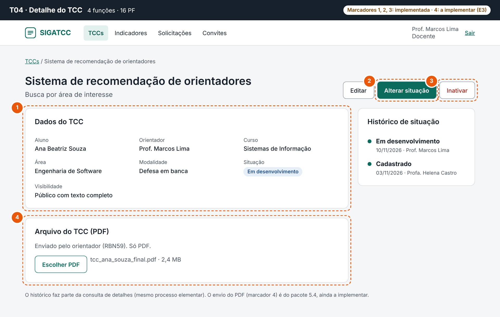{width=16.5cm}

| Nº | Função | Tipo | Complexidade | PF | Pacote · situação |
|---|----------------------|----|-------|---|------------|
| 1 | PF24 · Consultar detalhes do TCC | CE | Média | 4 | 5.1 · Implementada (E2) |
| 2 | PF26 · Alterar situação do TCC | EE | Média | 4 | 5.2 · Implementada (E2) |
| 3 | PF23 · Inativar TCC (soft delete) | EE | Média | 4 | 5.1 · Implementada (E2) |
| 4 | PF61 · Enviar arquivo do TCC | EE | Média | 4 | 5.4 · A implementar (E3) |
| | **Total da tela** | | | **16** | |

##### T05 · Registrar aprovação por publicação (4 PF)

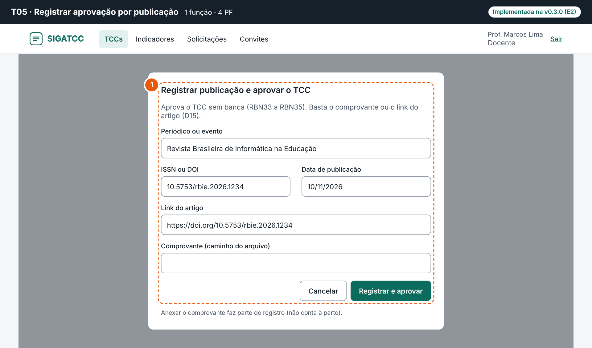{width=16.5cm}

| Nº | Função | Tipo | Complexidade | PF | Pacote · situação |
|---|----------------------|----|-------|---|------------|
| 1 | PF27 · Registrar aprovação por publicação (com comprovante ou link) | EE | Média | 4 | 5.3 · Implementada (E2) |
| | **Total da tela** | | | **4** | |

##### T06 · Cadastro de banca (12 PF)

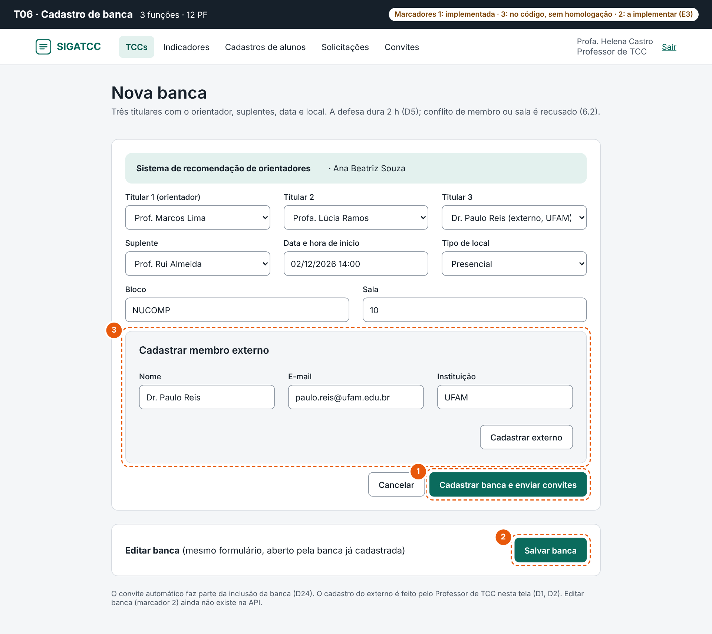{width=16.5cm}

| Nº | Função | Tipo | Complexidade | PF | Pacote · situação |
|---|----------------------|----|-------|---|------------|
| 1 | PF29 · Incluir banca (dispara os convites) | EE | Média | 4 | 6.1 · Implementada (E2) |
| 2 | PF30 · Alterar banca | EE | Média | 4 | 6.1 · A implementar (E3) |
| 3 | PF60 · Cadastrar membro externo | EE | Média | 4 | 4.6 · No código, sem homologação |
| | **Total da tela** | | | **12** | |

##### T07 · Banca e defesa (16 PF)

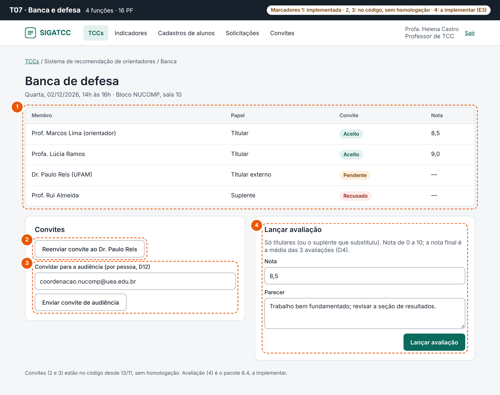{width=16.5cm}

| Nº | Função | Tipo | Complexidade | PF | Pacote · situação |
|---|----------------------|----|-------|---|------------|
| 1 | PF32 · Consultar banca | CE | Média | 4 | 6.1 · Implementada (E2) |
| 2 | PF33 · Reenviar convite | EE | Média | 4 | 6.3 · No código, sem homologação |
| 3 | PF34 · Enviar convite para audiência | EE | Média | 4 | 6.3 · No código, sem homologação |
| 4 | PF20 · Lançar avaliação (titular interno ou externo) | EE | Média | 4 | 6.4 · A implementar (E3) |
| | **Total da tela** | | | **16** | |

##### T08 · Convites recebidos (8 PF)

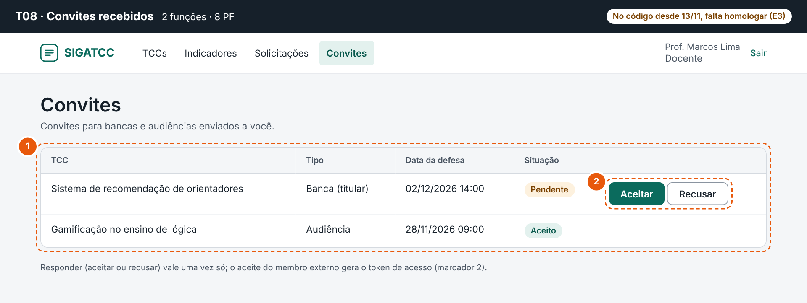{width=16.5cm}

| Nº | Função | Tipo | Complexidade | PF | Pacote · situação |
|---|----------------------|----|-------|---|------------|
| 1 | PF62 · Consultar convites recebidos | CE | Média | 4 | 6.3 · No código, sem homologação |
| 2 | PF35 · Responder convite (aceitar ou recusar) | EE | Média | 4 | 6.3 · No código, sem homologação |
| | **Total da tela** | | | **8** | |

##### T09 · Acesso temporário do membro externo (4 PF)

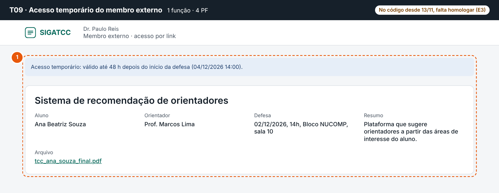{width=16.5cm}

| Nº | Função | Tipo | Complexidade | PF | Pacote · situação |
|---|----------------------|----|-------|---|------------|
| 1 | PF19 · Acessar TCC via token | CE | Média | 4 | 4.6 · No código, sem homologação |
| | **Total da tela** | | | **4** | |

##### T10 · Meu perfil (aluno) (8 PF)

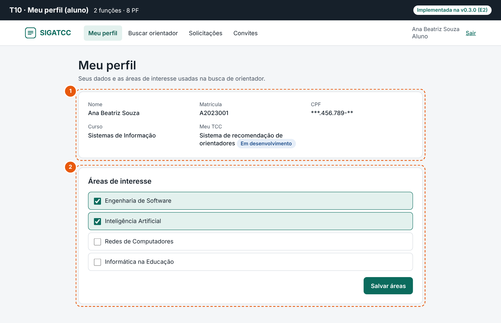{width=16.5cm}

| Nº | Função | Tipo | Complexidade | PF | Pacote · situação |
|---|----------------------|----|-------|---|------------|
| 1 | PF14 · Consultar perfil do aluno | CE | Média | 4 | 4.2 · Implementada (E2) |
| 2 | PF13 · Editar perfil do aluno (áreas de interesse) | EE | Média | 4 | 4.2 · Implementada (E2) |
| | **Total da tela** | | | **8** | |

##### T11 · Confirmação de cadastro de aluno (4 PF)

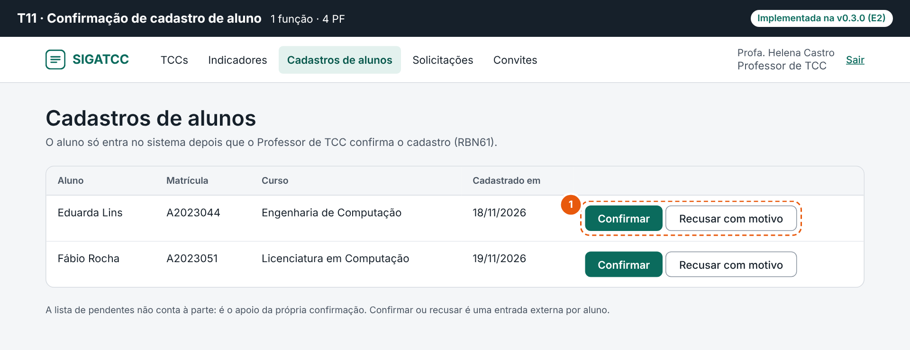{width=16.5cm}

| Nº | Função | Tipo | Complexidade | PF | Pacote · situação |
|---|----------------------|----|-------|---|------------|
| 1 | PF59 · Confirmar cadastro do aluno | EE | Média | 4 | 4.2 · Implementada (E2) |
| | **Total da tela** | | | **4** | |

##### T12 · Docentes (Administrador) (17 PF)

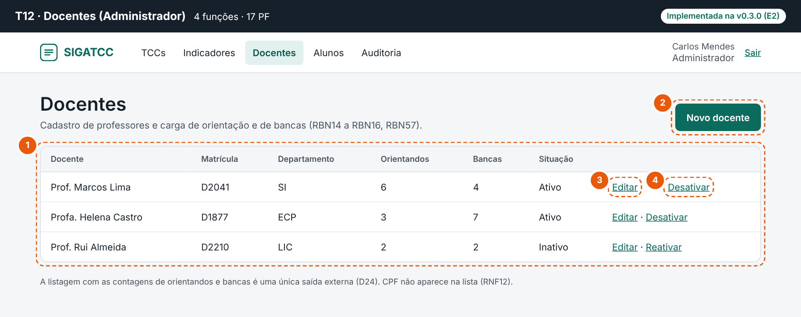{width=16.5cm}

| Nº | Função | Tipo | Complexidade | PF | Pacote · situação |
|---|----------------------|----|-------|---|------------|
| 1 | PF38 · Listar professores com orientandos e bancas | SE | Média | 5 | 7.1 · Implementada (E2) |
| 2 | PF36 · Incluir docente | EE | Média | 4 | 4.4 · Implementada (E2) |
| 3 | PF37 · Alterar docente | EE | Média | 4 | 4.4 · Implementada (E2) |
| 4 | PF17 · Desativar ou reativar conta de professor | EE | Média | 4 | 4.4 · Implementada (E2) |
| | **Total da tela** | | | **17** | |

##### T13 · Cadastro de aluno (Administrador) (4 PF)

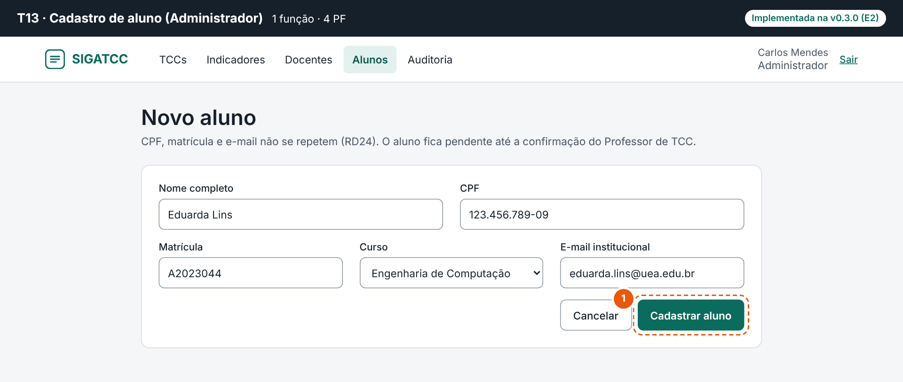{width=16.5cm}

| Nº | Função | Tipo | Complexidade | PF | Pacote · situação |
|---|----------------------|----|-------|---|------------|
| 1 | PF12 · Cadastro do aluno | EE | Média | 4 | 4.2 · Implementada (E2) |
| | **Total da tela** | | | **4** | |

##### T14 · Áreas de interesse do docente (4 PF)

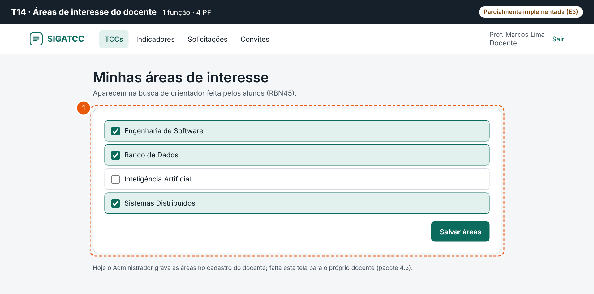{width=16.5cm}

| Nº | Função | Tipo | Complexidade | PF | Pacote · situação |
|---|----------------------|----|-------|---|------------|
| 1 | PF15 · Registrar áreas de interesse do docente | EE | Média | 4 | 4.3 · Parcial (E3) |
| | **Total da tela** | | | **4** | |

##### T15 · Buscar orientador (9 PF)

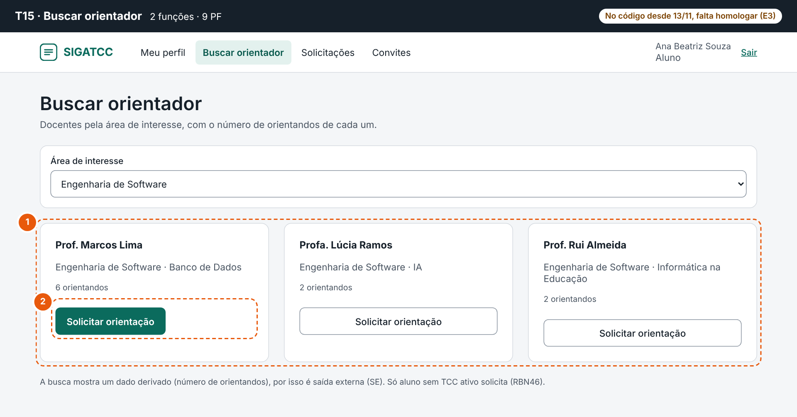{width=16.5cm}

| Nº | Função | Tipo | Complexidade | PF | Pacote · situação |
|---|----------------------|----|-------|---|------------|
| 1 | PF63 · Buscar orientador por área | SE | Média | 5 | 7.2 · No código, sem homologação |
| 2 | PF41 · Enviar solicitação de orientação | EE | Média | 4 | 7.2 · No código, sem homologação |
| | **Total da tela** | | | **9** | |

##### T16 · Solicitações de orientação e reuniões (16 PF)

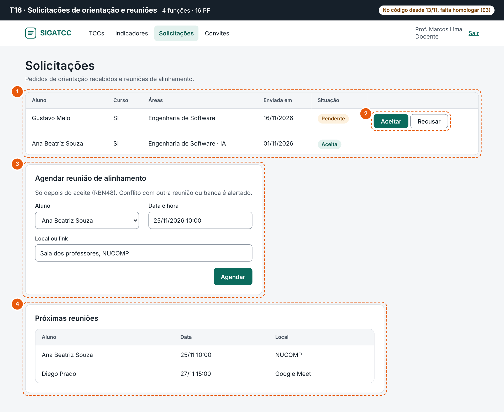{width=16.5cm}

| Nº | Função | Tipo | Complexidade | PF | Pacote · situação |
|---|----------------------|----|-------|---|------------|
| 1 | PF43 · Listar solicitações | CE | Média | 4 | 7.2 · No código, sem homologação |
| 2 | PF42 · Aceitar ou recusar solicitação | EE | Média | 4 | 7.2 · No código, sem homologação |
| 3 | PF44 · Agendar reunião de alinhamento | EE | Média | 4 | 7.3 · No código, sem homologação |
| 4 | PF45 · Consultar reuniões | CE | Média | 4 | 7.3 · No código, sem homologação |
| | **Total da tela** | | | **16** | |

##### T17 · Painel de indicadores (30 PF)

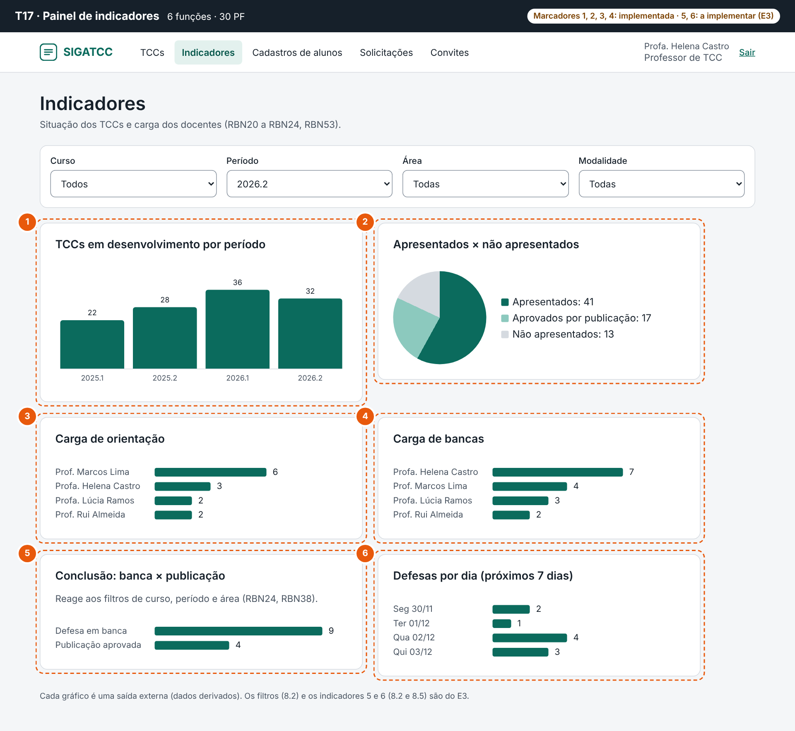{width=16.5cm}

| Nº | Função | Tipo | Complexidade | PF | Pacote · situação |
|---|----------------------|----|-------|---|------------|
| 1 | PF46 · Gráfico de TCCs em desenvolvimento por período | SE | Média | 5 | 8.1 · Implementada (E2) |
| 2 | PF47 · Gráfico apresentados × não apresentados | SE | Média | 5 | 8.1 · Implementada (E2) |
| 3 | PF48 · Gráfico de carga de orientação | SE | Média | 5 | 8.1 · Implementada (E2) |
| 4 | PF49 · Gráfico de carga de bancas | SE | Média | 5 | 8.1 · Implementada (E2) |
| 5 | PF50 · Indicador banca × publicação (com filtros) | SE | Média | 5 | 8.2 · A implementar (E3) |
| 6 | PF54 · Indicador de defesas por dia no dashboard | SE | Média | 5 | 8.5 · A implementar (E3) |
| | **Total da tela** | | | **30** | |

##### T18 · Relatório de defesas por dia (5 PF)

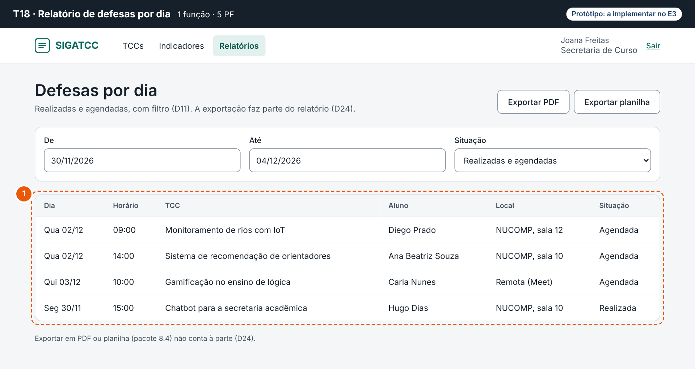{width=16.5cm}

| Nº | Função | Tipo | Complexidade | PF | Pacote · situação |
|---|----------------------|----|-------|---|------------|
| 1 | PF53 · Relatório de defesas por dia | SE | Média | 5 | 8.5 · A implementar (E3) |
| | **Total da tela** | | | **5** | |

##### T19 · Log de auditoria (4 PF)

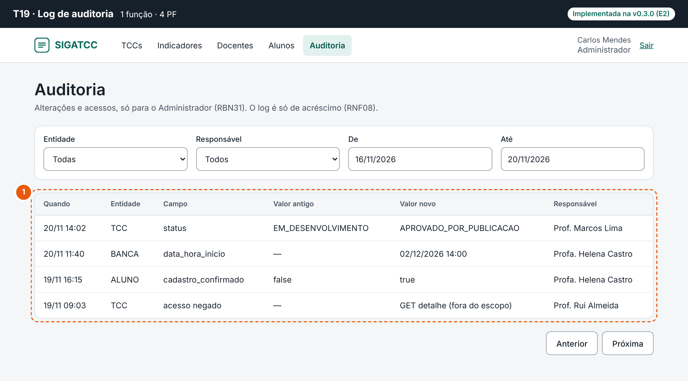{width=16.5cm}

| Nº | Função | Tipo | Complexidade | PF | Pacote · situação |
|---|----------------------|----|-------|---|------------|
| 1 | PF51 · Consultar log de auditoria | CE | Média | 4 | 8.3 · Implementada (E2) |
| | **Total da tela** | | | **4** | |

##### T20 · Consulta pública de TCCs (4 PF)

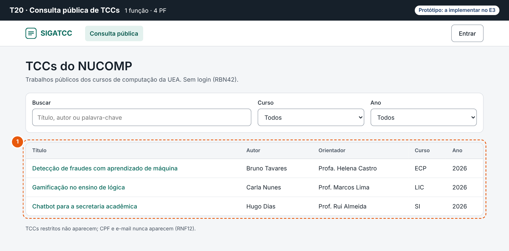{width=16.5cm}

| Nº | Função | Tipo | Complexidade | PF | Pacote · situação |
|---|----------------------|----|-------|---|------------|
| 1 | PF56 · Consulta pública de TCCs | CE | Média | 4 | 9.2 · A implementar (E3) |
| | **Total da tela** | | | **4** | |

##### T21 · Detalhe público do TCC (4 PF)

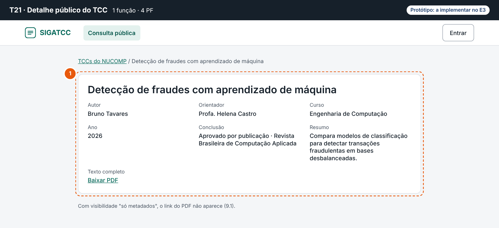{width=16.5cm}

| Nº | Função | Tipo | Complexidade | PF | Pacote · situação |
|---|----------------------|----|-------|---|------------|
| 1 | PF57 · Detalhe público do TCC | CE | Média | 4 | 9.2 · A implementar (E3) |
| | **Total da tela** | | | **4** | |

## 4. Do tamanho ao esforço e ao valor

| Parâmetro | Valor | Fonte |
|---|---|---|
| Produtividade de referência | 10 h/PF (**provisória**) | aba *Parâmetros*; recalibrada pela D25 (seção 6) |
| Valor-hora simbólico | R$ 40,00 | Plano de Integração, 4.1.4.1 |
| Custo por PF | 10 h × R$ 40,00 = **R$ 400,00/PF** | derivado |
| Esforço estimado | 234 PF × 10 h = **2.340 h** | derivado |
| Valor estimado (BAC) | 234 PF × R$ 400,00 = **R$ 93.600,00** | derivado |

O cronograma planeja **2.936 h** no total, mas só **736 h** estão nos pacotes que têm PF, o que dá **3,1 h/PF**. As outras 2.200 h são de pacotes que não geram função (requisitos, planos, testes, implantação, documentação e entregas). Ou seja, para os mesmos pacotes de software, a estimativa por PF (2.340 h) é cerca de três vezes o que o cronograma planejou por calendário.

Essa diferença é o principal ponto que a calibração da seção 6 precisa esclarecer: se a produtividade real ficar perto de 10 h/PF, o esforço dos pacotes de software da E2 e da E3 está subestimado no cronograma; se ficar perto de 3 h/PF, a referência de 10 h/PF deve baixar.

## 5. Métricas de avaliação

Todas saem da planilha de cronograma: as horas da aba *Horas*, o status (☐ ◐ ☑) da aba *Cronograma EAP* e os PF da aba *Pontos de Função*. Um pacote só conta como entregue quando está ☑ (mesclado na main e aceito na Sprint Review).

| Métrica | Fórmula | Para que serve |
|---|---|---|
| Tamanho entregue | Σ PF dos pacotes ☑ | Quanto do produto já existe |
| % do tamanho entregue | PF entregues ÷ 234 | Avanço real, comparado à seção 3.3 |
| Produtividade realizada | horas realizadas dos pacotes com PF ÷ PF entregues (h/PF) | Calibra a estimativa (seção 6) |
| Custo realizado por PF | custo realizado ÷ PF entregues (R$/PF) | Compara com os R$ 400,00/PF da linha de base |
| Desvio de esforço | (horas realizadas − horas estimadas) ÷ horas estimadas | Mostra se o pacote custou mais ou menos que o previsto |
| Variação de tamanho | (PF da recontagem − 234) ÷ 234 | Mostra crescimento de escopo (*scope creep*) |

### 5.1 Valor agregado medido em PF

Para ligar tamanho, prazo e custo (PMBOK 7, domínio de Medição), o valor agregado usa o PF como unidade de trabalho:

| Indicador | Fórmula | Leitura |
|---|---|---|
| VP (valor planejado) | PF planejados até a data × R$ 400,00 | Quanto deveria estar pronto |
| VA (valor agregado) | PF entregues × R$ 400,00 | Quanto está pronto |
| CR (custo real) | horas realizadas × R$ 40,00 | Quanto custou |
| IDP (desempenho de prazo) | VA ÷ VP | < 1: atrasado |
| IDC (desempenho de custo) | VA ÷ CR | < 1: acima do custo |
| EPT (estimativa no término) | 93.600 ÷ IDC | Custo final projetado |

**Exemplo com os dados de hoje (12/11):** os 81 PF da E1 estão entregues, então VA = 81 × 400 = R$ 32.400,00. No fim da E2, o VP será 150 × 400 = R$ 60.000,00; se a E2 fechar só com a E1 entregue, o IDP será 32.400 ÷ 60.000 = 0,54. O IDC ainda não pode ser calculado porque a aba *Horas* está vazia (seção 6).

### 5.2 Limites de alerta e resposta

| Situação | Limite | Resposta |
|---|---|---|
| Atraso | IDP < 0,90 em um marco | Replanejar no Sprint Planning; aplicar a ordem de corte da seção 4.1.2.4 do Plano de Integração |
| Estouro de custo | IDC < 0,90 | Rever a produtividade de referência e o esforço do próximo marco |
| Crescimento de escopo | Variação de tamanho > 10% | Abrir Formulário de Solicitação de Mudança (FSM) |
| Estimativa imprecisa | Produtividade realizada mais de 30% acima ou abaixo da referência vigente | Recalibrar na aba *Parâmetros* e registrar a mudança |

## 6. Calibração da produtividade (D25)

Os 10 h/PF são um valor de partida. A D25 manda substituí-los pela produtividade medida pela equipe.

1. **Lançar as horas da E1** na aba *Horas*, uma linha por sessão, como estimativa retroativa marcada como tal na coluna "O que foi feito". Hoje a aba só tem a linha de exemplo, então a calibração ainda **não foi feita**.
2. **Calcular a produtividade realizada da E1** (81 PF): a planilha mostra o valor na aba *Resumo* ("Produtividade real").
3. **Substituir** os 10 h/PF da aba *Parâmetros* pelo valor medido; o esforço e o valor da seção 4 se recalculam sozinhos.
4. **Repetir no fim da E2** com as horas reais (não retroativas) dos 69 PF da E2; a média ponderada das duas vira a referência da E3.
5. **Registrar** cada recalibração no Registro de Alterações do Plano de Integração (4.1.10) e recalcular o VME do risco R7, que hoje usa os 10 h/PF provisórios.

Prazo: passos 1 a 3 até a entrega do TP3 (18/11), com as horas lançadas por cada integrante.

## 7. Recontagem e refinamento

| Quando | O que fazer |
|---|---|
| A cada mudança de escopo aprovada (FSM) | Recontar as funções afetadas e registrar a variação de tamanho |
| Ao implementar cada transação | Preencher TD e AR na aba *Pontos de Função* (células amarelas), trocando a complexidade NESMA pela IFPUG detalhada |
| No fim da E3 (09/12) | Recontagem completa do que foi entregue; comparação com a linha de base de 08/11 |
| No encerramento (E4, 10/12) | Relatório final: PF entregues, produtividade realizada, IDC, IDP e lições aprendidas (seção 6.3 do Plano de Integração) |

Toda contagem ou recontagem é **revisada por 2 pessoas** antes de virar linha de base.

## 8. Responsabilidades

| Papel | Responsabilidade |
|---|---|
| Responsável pela contagem (Tiago Feitosa) | Mantém a aba *Pontos de Função*, conduz a recontagem e calcula os indicadores |
| Revisor da contagem (um segundo integrante, definido no planning) | Confere cada contagem antes de virar linha de base |
| Cada integrante | Lança as próprias horas na aba *Horas* toda semana, com o código do pacote |
| Scrum Master | Leva os indicadores à Sprint Review e aciona as respostas da seção 5.2 |
| Product Owner (Profa. Diana) | Aprova as mudanças de escopo que alteram o tamanho |

## 9. Relatório por marco

A cada marco, o status formal enviado à Product Owner (seção 4.1.6.5 do Plano de Integração) traz:

1. PF entregues e % do tamanho entregue, comparados à seção 3.3;
2. Produtividade realizada (h/PF) e custo por PF;
3. IDP, IDC e EPT;
4. Variação de tamanho desde a linha de base e FSM abertas;
5. Ações tomadas pelos limites da seção 5.2.
